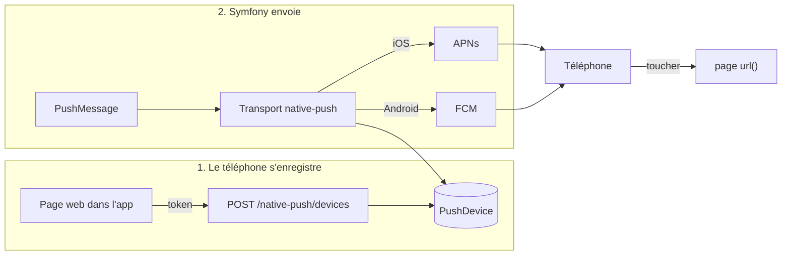

# akyos/native-push

Envoyez des notifications push à vos apps iOS et Android depuis Symfony, avec un simple `PushMessage`.

Le bundle stocke les téléphones de vos utilisateurs et choisit tout seul entre **APNs** (Apple) et **FCM** (Google). Il appelle leurs API directement, sans service tiers ni dépendance en dehors de Symfony. Quand on touche la notification, l'app peut s'ouvrir sur la page de votre choix.



Côté mobile, il faut les apps générées par [`akyos/ux-native-cli`](https://github.com/akyoscommunication/ux-native-cli) avec `php bin/console native:init --notification`. Ce sont elles qui fournissent le token du téléphone et qui ouvrent la bonne page au toucher.

---

## Sommaire

1. [Démarrage rapide](#démarrage-rapide)
2. [Identifiants iOS et Android](#identifiants-ios-et-android)
3. [Enregistrer le téléphone](#enregistrer-le-téléphone)
4. [Envoyer une notification](#envoyer-une-notification)
5. [Ce que le bundle gère tout seul](#ce-que-le-bundle-gère-tout-seul)
6. [Commandes](#commandes)
7. [Dépannage](#dépannage)
8. [Référence de configuration](#référence-de-configuration)
9. [Limites](#limites)

---

## Démarrage rapide

**1. Activer le bundle**

```php
// config/bundles.php
Akyos\NativePushBundle\AkyosNativePushBundle::class => ['all' => true],
```

**2. Importer les routes** (endpoint d'enregistrement des téléphones)

```yaml
# config/routes/akyos_native_push.yaml
akyos_native_push:
    resource: '@AkyosNativePushBundle/config/routes.php'
```

**3. Déclarer le transport Notifier**

```yaml
# config/packages/notifier.yaml
framework:
    notifier:
        texter_transports:
            native_push: '%env(NATIVE_PUSH_DSN)%'
```

```dotenv
# .env
NATIVE_PUSH_DSN=native-push://default
```

**4. Créer la table des appareils**

```bash
php bin/console doctrine:migrations:diff
php bin/console doctrine:migrations:migrate
```

**5. Rendre votre entité destinataire**

N'importe quelle entité Doctrine fait l'affaire : un `User`, un `Customer`, une `Team`…

```php
use Akyos\NativePushBundle\Model\PushSubjectInterface;
use Akyos\NativePushBundle\Model\PushSubjectTrait;

#[ORM\Entity]
class User implements UserInterface, PushSubjectInterface
{
    use PushSubjectTrait; // fournit getPushSubjectId() à partir de getId()

    // ...
}
```

**6. Vérifier**

```bash
php bin/console native-push:check
```

Sans identifiants, la commande affiche « non configuré » pour chaque plateforme. C'est normal : ajoutez-les à l'étape suivante.

---

## Identifiants iOS et Android

Les deux plateformes sont **facultatives et indépendantes**. Vous pouvez n'activer qu'Android, qu'iOS, ou les deux. Les appareils d'une plateforme non configurée sont ignorés : l'envoi ne plante pas, et un avertissement est écrit dans le log.

Rangez les fichiers de clés dans `config/push/`, et ajoutez ce dossier au `.gitignore`.

### iOS : clé APNs (`.p8`)

1. Sur [developer.apple.com](https://developer.apple.com/account), allez dans **Certificates, Identifiers & Profiles → Keys → « + »**.
2. Cochez **Apple Push Notifications service (APNs)**, validez, puis **téléchargez** `AuthKey_XXXXXXXXXX.p8`. Apple ne le propose qu'une seule fois.
3. Notez le **Key ID** (les 10 caractères du nom du fichier) et votre **Team ID** (rubrique *Membership details*).

```yaml
# config/packages/akyos_native_push.yaml
akyos_native_push:
    apns:
        team_id: 8WS3LS7L99                     # exemple
        key_id: '%env(APNS_KEY_ID)%'
        private_key: '%kernel.project_dir%/config/push/AuthKey.p8'
        topic: com.akyos.nativecli              # le bundle ID de l'app iOS
        sandbox: '%kernel.debug%'
```

`sandbox` doit correspondre à la façon dont l'app a été installée :
- `true` pour une app lancée depuis Xcode ou `native:build` (build de développement) ;
- `false` pour TestFlight et l'App Store.

Il faut une **Team Apple Developer payante**. Une *Personal Team* gratuite ne peut pas recevoir de push.

### Android : compte de service Firebase

1. Dans la [console Firebase](https://console.firebase.google.com/), ouvrez **Paramètres du projet → Comptes de service**.
2. Cliquez sur **Générer une nouvelle clé privée** et enregistrez le JSON dans `config/push/firebase-service-account.json`.

```yaml
akyos_native_push:
    fcm:
        service_account: '%kernel.project_dir%/config/push/firebase-service-account.json'
```

> Ne confondez pas les deux fichiers Firebase :
> - le **compte de service** (ci-dessus) va sur le **serveur** ;
> - `google-services.json` va dans l'**app Android** (`native/android/app/`), et son nom de package doit être celui de `application_id`.

Relancez `php bin/console native-push:check` : chaque plateforme configurée doit afficher **OK**.

---

## Enregistrer le téléphone

L'app mobile donne son token à la page web. Le contrôleur Stimulus `native-push` l'envoie ensuite au serveur.

**1. Charger le contrôleur**

```php
// importmap.php
'@akyos/native-push' => [
    'path' => '@akyos/native-push/controllers/native_push_controller.js',
],
```

```js
// assets/stimulus_bootstrap.js
import NativePushController from '@akyos/native-push';

app.register('native-push', NativePushController);
```

**2. L'utiliser dans une page**

```twig
<div data-controller="bridge--notification-token native-push"
     data-action="bridge--notification-token:retrieved->native-push#register">
    <button data-action="bridge--notification-token#get">Activer les notifications</button>
    <p data-native-push-target="status"></p>
</div>
```

Au clic, le système demande l'autorisation, l'app renvoie le token, et le contrôleur le poste sur `POST /native-push/devices`. La plateforme est déduite automatiquement du User-Agent de l'app.

**3. À qui appartient le téléphone ?**

Par défaut, le téléphone est rattaché à **l'utilisateur connecté**, s'il implémente `PushSubjectInterface`. Sans utilisateur connecté, l'endpoint répond `401`.

Pour un autre choix, implémentez `SubjectResolverInterface` et déclarez-le :

```php
use Akyos\NativePushBundle\SubjectResolver\SubjectResolverInterface;

final class CustomerResolver implements SubjectResolverInterface
{
    public function __construct(private CustomerRepository $customers) {}

    public function resolve(Request $request): ?PushSubjectInterface
    {
        return $this->customers->findOneByCookie($request->cookies->get('customer'));
    }
}
```

```yaml
akyos_native_push:
    subject_resolver: App\Push\CustomerResolver
```

**Désinscrire à la déconnexion** : `DELETE /native-push/devices` avec `{"token": "..."}`.

**Depuis PHP** (sans passer par la page) : `$pushDeviceManager->register($user, $token, Platform::Ios)`.

---

## Envoyer une notification

```php
use Akyos\NativePushBundle\Transport\NativePushOptions;
use Symfony\Component\Notifier\Message\PushMessage;
use Symfony\Component\Notifier\TexterInterface;

// Toucher la notification ouvre l'app sur /orders/42
$texter->send(new PushMessage(
    'Commande prête',
    'Votre commande #42 est prête',
    NativePushOptions::to($user)->url('/orders/42'),
));

// Sans url() : toucher ouvre simplement l'app là où elle en était
$texter->send(new PushMessage('Rappel', 'Pensez à valider', NativePushOptions::to($user)));
```

Ou avec le Notifier et le canal `push` :

```php
use Akyos\NativePushBundle\Notification\PushNotification;

$notifier->send(new PushNotification('Commande prête', 'Votre commande #42 est prête', url: '/orders/42'), $user);
```

### Options de `NativePushOptions`

| Méthode | Rôle |
| --- | --- |
| `to($subject)` | Envoie à tous les téléphones de ce sujet. |
| `tokens([...], Platform::Ios)` | Envoie à des tokens précis, sans passer par un sujet. |
| `url('/orders/42')` | Page ouverte au toucher : un chemin, résolu sur l'URL de l'app, ou une URL complète. |
| `data(['orderId' => 42])` | Données personnalisées transmises à l'app. |
| `badge(3)` | Pastille sur l'icône de l'app. |
| `sound(null)` | Notification silencieuse. Par défaut, le son est `default`. |

Sur iOS comme sur Android, toucher une notification **ouvre toujours l'app** : c'est le système qui décide. `url()` choisit seulement la page affichée.

---

## Ce que le bundle gère tout seul

- **Pas de doublons.** Un token n'existe qu'une fois en base. Si un téléphone s'enregistre pour un autre compte, il est **déplacé** vers ce compte au lieu d'être dupliqué.
- **Nettoyage des téléphones morts.** Quand Apple ou Google répond que le token n'existe plus (app désinstallée…), l'appareil est supprimé :
  - chez Apple, la réponse `410 Unregistered` ;
  - chez Google, `UNREGISTERED` ou « invalid registration token ».

  La réponse APNs `BadDeviceToken` n'efface **rien** : elle arrive aussi quand `sandbox` est mal réglé, et on ne veut pas vider la base à cause d'une erreur de config.
- **Choix de la plateforme.** Chaque téléphone part vers APNs ou FCM selon sa plateforme. Une plateforme non configurée est ignorée.
- **Envoi en parallèle.** Tous les téléphones d'un sujet sont contactés en même temps.
- **Pas de plantage inutile.** Un sujet sans téléphone n'est pas une erreur. Une exception n'est levée que si **tous** les envois tentés ont échoué.
- **Compatible Messenger.** On peut router `PushMessage` vers un transport asynchrone, car les options ne contiennent que des valeurs simples.
- **Jetons d'authentification en cache.** Le JWT APNs est gardé 50 minutes et le jeton OAuth Google 55 minutes, puis ils sont renouvelés.

---

## Commandes

| Commande | À quoi elle sert |
| --- | --- |
| `native-push:check` | Vérifie les identifiants de chaque plateforme, sans rien envoyer. |
| `native-push:devices [--subject='App\Entity\User#1']` | Liste les téléphones enregistrés. |
| `native-push:send 'App\Entity\User' 1 [--title] [--body] [--url] [--data=cle=valeur]` | Envoie à tous les téléphones d'un sujet, comme le ferait votre code. |
| `native-push:test <token> [--platform=ios\|android] [--title] [--body] [--url]` | Envoie à un token brut et affiche la **réponse brute** d'Apple ou de Google (pratique pour déboguer). |

### Tester de bout en bout

```bash
php bin/console native-push:check                    # 1. les identifiants sont OK
# 2. dans l'app, touchez « Activer les notifications »
php bin/console native-push:devices                  # 3. le téléphone apparaît
# 4. mettez l'app en arrière-plan, puis :
php bin/console native-push:send 'App\Entity\User' 1 --url=/profile
```

Touchez la notification : l'app s'ouvre sur `/profile`.

---

## Dépannage

| Symptôme | Cause | Solution |
| --- | --- | --- |
| Log « Push ignoré : android non configuré » | La section `fcm` (ou `apns`) est absente. | Ajoutez-la ([Identifiants](#identifiants-ios-et-android)). |
| « Aucun appareil joignable » | Le sujet n'a pas de téléphone enregistré, ou sa plateforme n'est pas configurée. | Vérifiez avec `native-push:devices` et `native-push:check`. |
| `APNs BadDeviceToken` | Token de build de dev envoyé en production, ou l'inverse. | Réglez `apns.sandbox` : `true` pour Xcode, `false` pour TestFlight ou App Store. |
| `APNs DeviceTokenNotForTopic` | `apns.topic` ne correspond pas au bundle ID de l'app. | Mettez le même bundle ID que dans `native.yaml`. |
| iOS : aucun token, rien ne se passe | Simulateur, ou app signée sans Team payante. | Testez sur un vrai iPhone, signé avec une Team Apple Developer payante. |
| Xcode : `No Account for Team` | Le compte de cette Team n'est pas chargé dans Xcode, ou ses conditions Apple ne sont pas acceptées. | Dans Xcode → *Settings → Accounts*, la Team doit apparaître sans croix rouge. |
| Android : build en échec « No matching client found for package name » | `google-services.json` a été créé pour un autre `application_id`. | Ajoutez une app Android avec le bon package dans Firebase, puis téléchargez son `google-services.json`. |
| Android : aucun token | `google-services.json` manquant dans `native/android/app/`. | Ajoutez-le, puis rebuildez. |
| `Texter::send()` renvoie toujours `null` | Normal quand Messenger est installé : le Texter confie le message au bus. | Utilisez `native-push:send` ou le service `texter.transports` pour voir le résultat réel. |
| Endpoint en `401` | Aucun utilisateur connecté, ou l'utilisateur n'implémente pas `PushSubjectInterface`. | Connectez-vous, ou configurez un `subject_resolver`. |
| Endpoint en `403` | Requête qui n'est pas en JSON ou qui vient d'un autre domaine. | Utilisez le contrôleur `native-push`, qui envoie la bonne requête. |

---

## Référence de configuration

```yaml
# config/packages/akyos_native_push.yaml
akyos_native_push:
    # iOS, facultatif. Si la section est présente, toutes ses clés sont obligatoires.
    apns:
        team_id: XXXXXXXXXX        # Team ID Apple
        key_id: XXXXXXXXXX         # Key ID de la clé APNs
        private_key: '...'         # chemin du .p8, ou son contenu PEM (pratique avec %env()%)
        topic: com.exemple.app     # bundle ID de l'app iOS
        sandbox: true              # true = api.sandbox.push.apple.com (builds de dev)

    # Android, facultatif.
    fcm:
        service_account: '...'     # chemin du JSON du compte de service, ou son contenu

    # Qui possède le téléphone qui s'enregistre (service qui implémente SubjectResolverInterface).
    subject_resolver: Akyos\NativePushBundle\SubjectResolver\SecurityUserResolver
```

Un fichier de clé introuvable ne bloque pas le démarrage de l'app : l'erreur apparaît au premier envoi et dans `native-push:check`.

---

## Limites

- **Un seul environnement APNs par app.** Avec `sandbox`, on ne peut pas mélanger des builds Xcode et des builds TestFlight sur le même serveur.
- **Renouvellement du token.** Quand Firebase renouvelle le token d'un téléphone, le nouveau n'est envoyé au serveur que la prochaine fois qu'une page appelle `bridge--notification-token#get`.
- **Push iOS.** Il faut une Team Apple Developer payante, une app signée et un vrai iPhone : le simulateur ne reçoit pas de token.

## Tests

```bash
php bin/phpunit lib/akyos/AkyosNativePushBundle/tests
```

Ils couvrent :
- les doublons et la réattribution des tokens, sur SQLite en mémoire ;
- le transport : plateforme ignorée, tokens morts supprimés ;
- les payloads APNs et FCM, et les signatures JWT, vérifiées avec `openssl_verify`.
